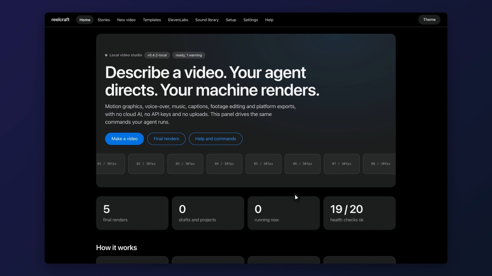

# 10 · Launch video: the reelcraft panel (32 s, 16:9)

A tour of `reelcraft ui`, the web panel that runs on your own machine. The picture is a real recording of the
panel (`reelcraft demo record`, then `autozoom`), the narration is a local Kokoro voice, and the whole cut was
assembled with `reelcraft edit render`. Nothing was sent anywhere.

- **Video:** [`final.mp4`](https://github.com/fib1618agent/reelcraft-examples/releases/download/examples-media-v1/10-launch-reelcraft--final.mp4), 1920x1080, 30 fps, 31.7 s, H.264 + AAC, 10.2 MB, -14 LUFS
- **Captions sidecar:** [`final.srt`](final.srt) (from the narration's word times; not burned in)
- **Credits:** [`credits.txt`](credits.txt): the music is CC-BY 4.0 and needs its credit line
- **Share copy:** [`share.txt`](share.txt)
- **Source:** [`project/`](project): `panel-tour.mjs` (the recording script), `narration.md`, `edl.json`.
  The earlier launch film's source is kept in [`project-v1/`](project-v1).

## What it shows

Home, Stories (each final render with its cover, then one story open and playing), New video (the prompt box, then
the plan that comes back from your agent), Templates (eight starting points with real examples), and the Sound
library, in that order, each on screen while the narration names it.

## How it was made

1. A throwaway panel with five sample stories (the example renders), so no personal project shows:
   `REELCRAFT_EXAMPLES=<examples> reelcraft ui --base <demo>/reelcraft-out --port 4890 --no-key`
2. `reelcraft demo record project/panel-tour.mjs <out> --url http://127.0.0.1:4890 --dark`, then `reelcraft autozoom <out>`.
3. `reelcraft voice script project/narration.md -o voice` (voice `af_heart`, each line pinned to its page with `at`).
4. `reelcraft edit render <job> -o final.mp4` with `project/edl.json` (the voice plus the bed, mastered to -14 LUFS).

`reelcraft qa`: **WARN**, 0 fail. The holds it lists (the opening and the typing step) are narrated reading time;
its "video player strip" note is the page's own table, not a player. No critic round was run on this cut.
